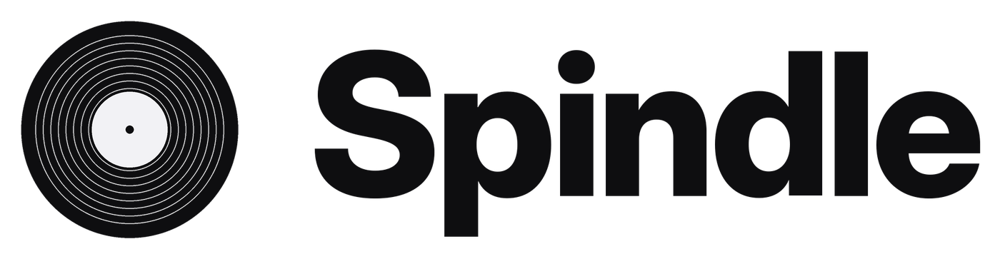
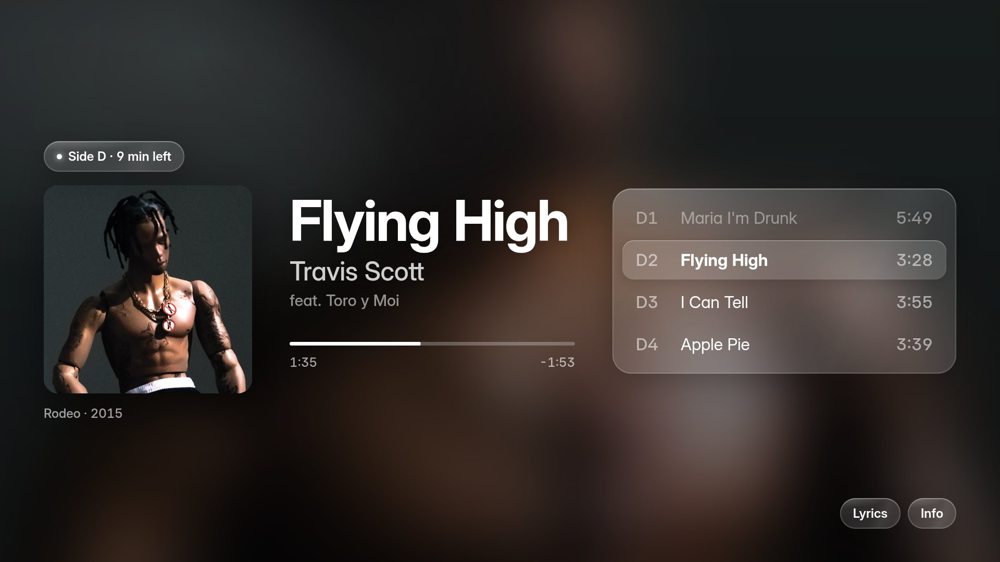
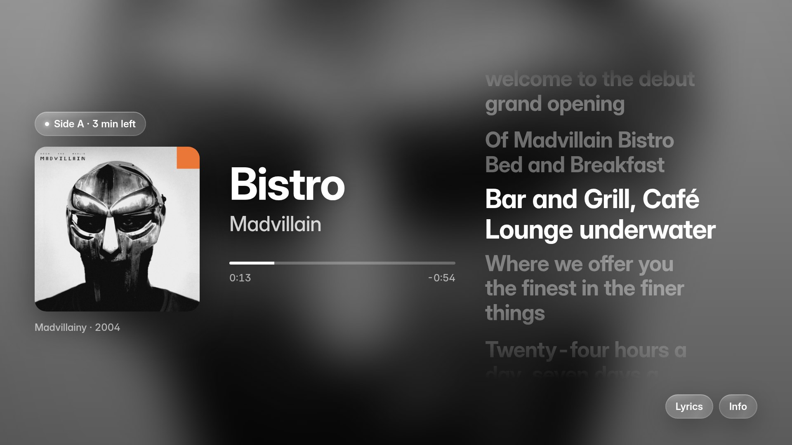
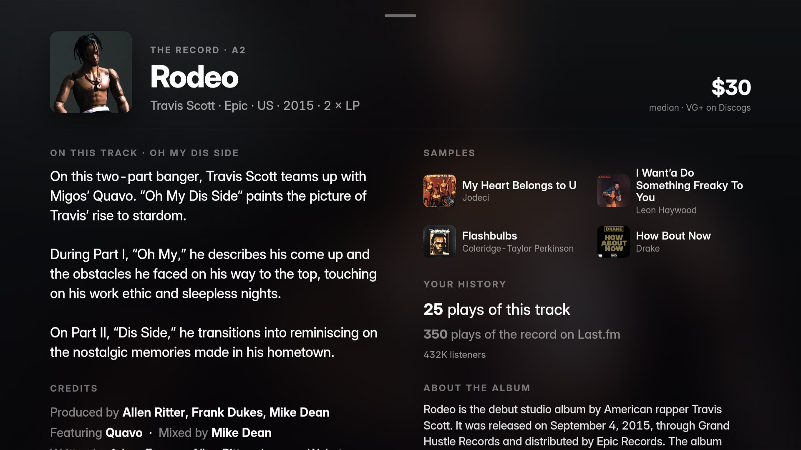
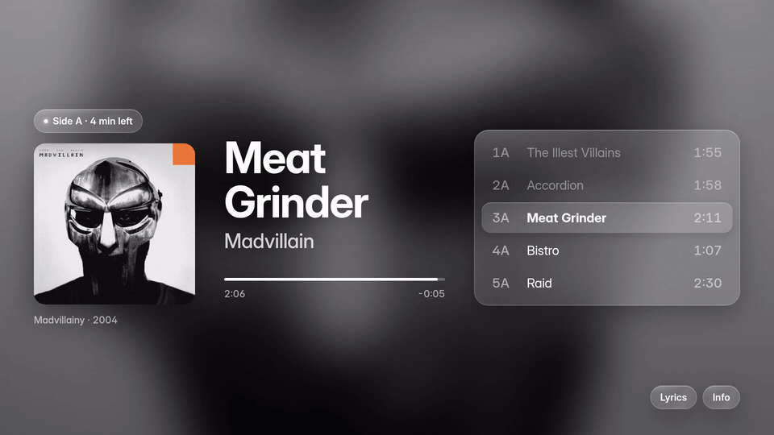
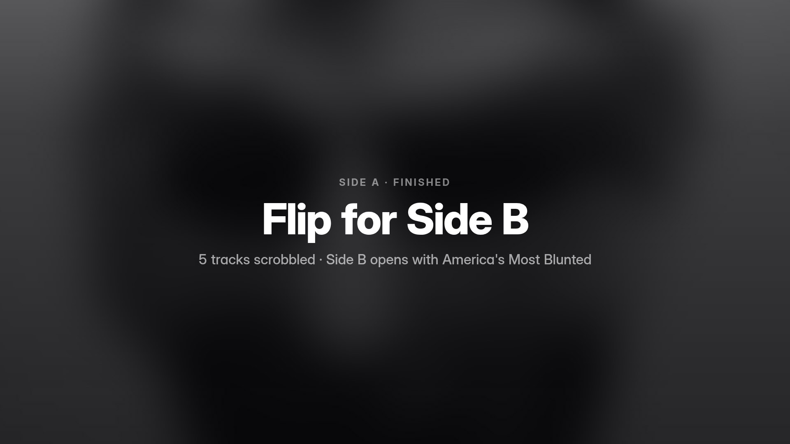
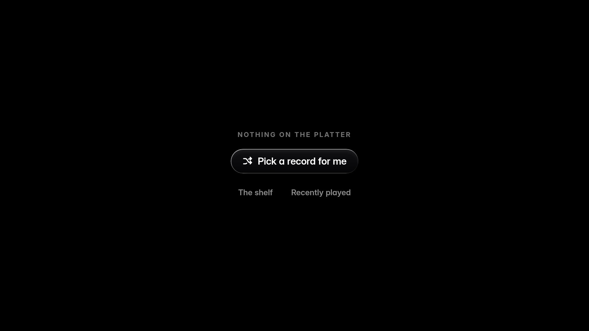
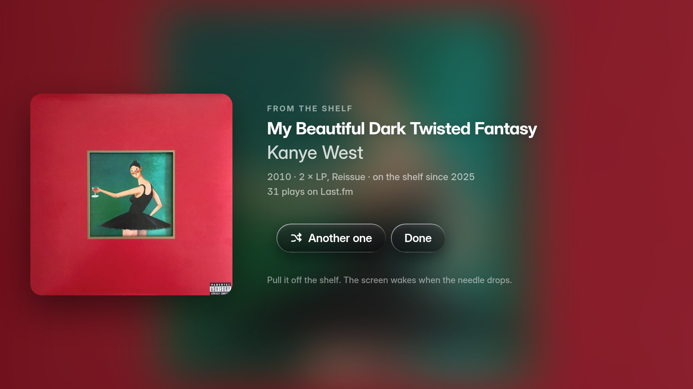
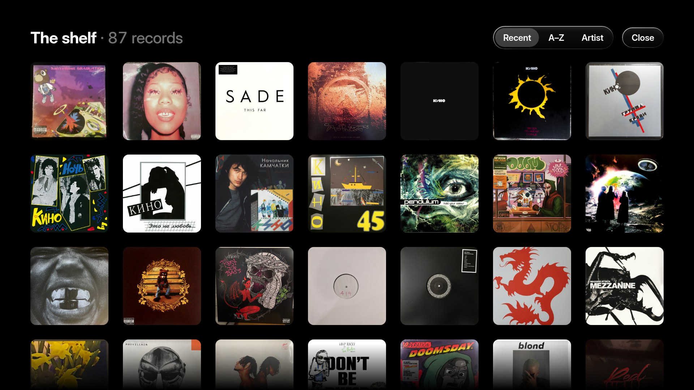

<p align="center">
  <picture>
    <source media="(prefers-color-scheme: dark)" srcset="docs/logo-dark.png">
    
  </picture>
</p>

<p align="center">
  <strong>A vinyl scrobbler and now-playing display, on a Raspberry Pi beside the turntable.</strong><br>
  It hears what the record is playing, works out which record it is, scrobbles the whole side to Last.fm,
  and puts the cover, the lyrics and the liner notes on a touch screen on the wall.
</p>

<p align="center">
  <a href="https://github.com/LuKresXD/spindle/actions/workflows/ci.yml"></a>
  <a href="https://github.com/LuKresXD/spindle/blob/main/LICENSE"></a>
  <a href="https://www.python.org/"></a>
  <a href="https://www.last.fm/user/LuKresXD"></a>
</p>

<p align="center">
  
</p>

---

## What it does

Spindle listens to a split of the turntable's line-out through a USB audio adapter. Every two
seconds it fingerprints the last few seconds of audio (ShazamIO, with AcoustID as a second
opinion), asks which record is on the platter, and locks onto that record's tracklist. From then
on it knows where you are in the side: it scrobbles each track to Last.fm as it ends, with the
canonical Spotify names so vinyl plays stack with streaming plays, backfills what played before
the first match, and stops at the end of the side to wait for the flip.

Your **Discogs collection is the prior**. When a track sits on the album, a single and three
compilations, the pressing you own wins, and a record Spotify never got still locks from the
Discogs tracklist alone. The design is written up in [`docs/ENGINE.md`](docs/ENGINE.md).

## The display

<p align="center">
  
  
</p>
<p align="center">
  
</p>

Since v0.3 the screen is a web page Spindle serves itself, shown full screen by Chromium under
the `cage` Wayland compositor on a 13.3-inch 1080p OLED with touch. Everything sits on the
blurred cover; idle is pure black, so the panel is off until the needle drops.

- **Now playing**: cover, title, artist, the feature credit on its own line, progress with
  "Side A · 9 min left", this side's tracklist with the current track lit and played tracks dimmed.
- **Lyrics**: tap the title or **Lyrics**. Time-synced lines from [LRCLIB](https://lrclib.net),
  on the engine's clock, which the fingerprint offsets pin to within a second.
- **Info**: swipe up or **Info** for the liner notes. The pressing from Discogs (label, country,
  year, format, the median price of a VG+ copy), the story behind the track and the songs it
  samples from Genius (with their covers), credits as prose from the Discogs per-track credits,
  your plays of the track and of the record from Last.fm, and the album's story from Wikipedia.
  Everything is prefetched on each track change, so it opens at once.
- **End of side**: "Side A · finished / Flip for Side B / 5 tracks scrobbled". A tap goes to the
  Off page; a new record brings the screen back.

<p align="center">
  
</p>

- **Three pages in a ring** (v0.4): swipe left or right between **Off** (black on purpose: the page
  dots and the word fade out after two seconds, a tap shows them again), **Spindle** (the record)
  and **Claw** (a placeholder for now). The pages follow the finger and settle; a needle drop
  always brings Spindle back, whatever page is up.
- **Nothing on the platter**: the Spindle page is black until a tap reveals the controls, which
  fade again after twelve seconds. **Pick a record for me** draws one of the records at random
  while the covers wheel past; the pick lands with its cover as the backdrop, the original release
  year, the pressing, when it joined the shelf and your Last.fm plays, and the screen then waits
  for the needle ("Another one" draws again). **The shelf** is every cover in a grid, sorted by
  arrival, title or artist; a tap opens that record's card. **Recently played** is the last
  records that were on, from the scrobble history.
- **Gestures**: swipe down, tap the top band or pull past the top to close Info; swipe left or
  right to change the page; tap a black Spindle page for the controls.

<p align="center">
  
  
</p>
<p align="center">
  
</p>

## How it hears

- **Continuous capture**: one `arecord` feeding a ring buffer; every fingerprint window is
  contiguous audio, a new attempt every 2 s. The card's capture gain is set at start so a
  line-level deck neither clips nor idles in the noise.
- **Music, not noise**: a session starts only when the level clears the gate *and* the spectrum
  moves like music; a running turntable with no record stays dark.
- **Offsets**: Shazam says where in the song the matched window sits. Two agreeing offsets pin
  the track's start; a needle dropped mid-song counts from the song's true start; the ratio of
  offsets to wall-clock measures the deck's speed, and the timing model runs at that speed.
- **Album-lock**: identify once, scrobble the side. Backfill what played before the first match,
  fill gaps the fingerprinter missed (bounded by the clock), advance by duration, re-lock onto a
  better tracklist when one appears (the album after a single, the owned pressing once the
  collection has loaded), never trade an owned pressing for a streaming edition.
- **Any order**: play 3, go back to 1, play 2 and 3 again: each play is its own scrobble.
- **Last.fm's rules**: half the track or four minutes; an outbox thread with an offline queue
  that survives reboots; a scrobble Last.fm rejects is reported, not retried forever.
- **Telegram as a log** (v0.4): no bot, no commands. One card when Spindle comes up (and whether
  after a boot, a clean stop or a crash), a card at once when something is dropped for good (a
  rejected scrobble), WARNING log lines as a digest at most every ten minutes, and a word when
  the offline queue gets through. Silent by default.

## Hardware

| Component | Used here | Notes |
|-----------|-----------|-------|
| Raspberry Pi | Pi 4 (2 GB) | Any model with USB and network |
| USB audio adapter | [Plugable USB-AUDIO](https://plugable.com/products/usb-audio) | Stereo line-level input |
| RCA Y-splitters + RCA → 3.5 mm | any | Split the deck's output to the speakers and the Pi |
| Display *(optional)* | 13.3" 1080p OLED portable touch monitor | HDMI for video, its second USB-C to the Pi for touch. Any HDMI panel works; the framebuffer renderer still drives the Waveshare 3.5" SPI LCD |

```
Turntable (phono out) → preamp / receiver (line out)
    ↓
RCA Y-splitter
    ├── speakers
    └── RCA → 3.5 mm → USB audio adapter → Raspberry Pi → Last.fm
                                                   └→ HDMI → OLED
```

> The Pi needs a **line-level** signal, not phono. A turntable with a built-in preamp or a
> receiver's line/tape out is fine.

## Quick start

```bash
sudo apt install -y python3-pip python3-venv ffmpeg libchromaprint-tools portaudio19-dev alsa-utils
git clone https://github.com/LuKresXD/spindle.git && cd spindle
python3 -m venv venv && source venv/bin/activate
pip install -e .
cp config.example.yaml config.yaml
```

Fill in `config.yaml`:

| Service | Key | Needed for |
|---------|-----|-----------|
| [Last.fm](https://www.last.fm/api/account/create) | API account | scrobbling |
| [Spotify](https://developer.spotify.com/dashboard) | app | canonical names and tracklists (Deezer's public API steps in without a key when Spotify cannot answer) |
| [AcoustID](https://acoustid.org/new-application) | application key, optional | a second fingerprinter (`fingerprint.acoustid_fallback`) |
| [Discogs](https://www.discogs.com/settings/developers) | personal token + username | your collection as the prior, side positions, pressing and price |

Find the audio device with `arecord -l` (`plughw:CARD=Device,DEV=0` for the Plugable), then:

```bash
spindle --dry-run -v      # identify without scrobbling
spindle -v                # the real thing
```

Install as a service so it starts on boot and restarts on a crash, or on a hang (the unit
carries a 90 s watchdog; the tick loop sends systemd a keep-alive every 2 s):

```bash
sudo cp spindle.service /etc/systemd/system/
sudo systemctl daemon-reload && sudo systemctl enable --now spindle
journalctl -u spindle -n 100
```

### The kiosk (touch display)

Raspberry Pi OS, console boot (no desktop session: it would take the display), user `luka`:

```bash
sudo apt install cage chromium
sudo cp spindle-kiosk.service /etc/systemd/system/
sudo cp spindle-touch.rules /etc/udev/rules.d/98-spindle-touch.rules   # the touch controller's mouse half and the HDMI CEC inputs stay off the seat
python3 tools/make_blank_cursor.py ~/.icons/blank
sudo systemctl daemon-reload && sudo systemctl enable --now spindle-kiosk
```

```yaml
web:
  enabled: true           # Spindle serves the display at http://127.0.0.1:8787/
display:
  enabled: false          # the kiosk owns the screen; the framebuffer renderer is the fallback
```

The kiosk waits for `/healthz`, then opens the page. Static changes to the page need no engine
restart: reload the browser (its DevTools port is on localhost) and the engine never notices.

## Configuration

See [`config.example.yaml`](config.example.yaml) for everything. The settings that matter most:

```yaml
audio:
  device: "plughw:CARD=Device,DEV=0"
  chunk_duration: 10         # fingerprint window (s); a new window every 2 s
  capture_gain_db: 14        # the card's capture gain, set at start (31 dB clips a line-level deck)

silence:
  threshold_db: -45          # a line-level USB capture idles around -50 dB
  start_margin_db: 6         # music must clear threshold + margin ...
  start_ticks: 2             # ... for two ticks (run-out noise sits at the threshold)
  min_silence_seconds: 8     # quiet this long = the side is over

discogs:
  token: ""                  # your collection decides which album a track belongs to
  username: ""

scrobble:
  min_play_seconds: 30
```

## Architecture

```
spindle/
├── cli.py          # wiring + the 2 s tick loop
├── engine.py       # Player + IdentifyWorker: phases, identification off-thread, ScreenState
├── capture.py      # continuous arecord → ring buffer; levels, spectral motion, capture gain
├── fingerprint.py  # ShazamIO (with offsets) + AcoustID, corrections
├── resolve.py      # fingerprint → album: Discogs collection, locked album, album > single
├── session.py      # album-lock: side-aware timing, offsets, deck speed, backfill, re-lock, any order
├── tracklist.py    # AlbumTracklist, sides, Discogs ↔ Spotify merge
├── discogs.py      # your collection, tracklists, pressing details, marketplace prices
├── spotify.py      # candidates, canonical names, tracklists
├── scrobbler.py    # Last.fm outbox thread, offline queue, play counts
├── art.py          # cover art: Apple 1200 px → Deezer → Spotify
├── web.py          # the display: SSE state, lyrics (LRCLIB), Info (Discogs, Genius, Wikipedia, Last.fm)
├── web_static/     # the page: index.html, style.css, app.js (Inter, no framework)
├── display.py      # framebuffer renderer (the fallback)
├── state.py        # ScreenState / TrackRow: what any renderer draws from
├── history.py      # scrobble log for stats
├── notify.py       # Telegram as the log channel: start, error and digest cards
└── config.py       # YAML config
```

About 8,800 lines of Python, 2,000 lines of page, 200 tests. `ruff`, `mypy` and `pytest` run in CI.
`tools/shelf_replay.py` plays your own shelf through the resolver and the session, offline after the
first run: run it before and after a change to the engine.

## History

- **v0.1** (March 2026): capture, fingerprinting, Last.fm scrobbling, album-lock with backfill,
  offline queue, Telegram bot, the first LCD screen. Built in four days.
- **v0.2** (November 2026): the Discogs collection as the identification prior, side-aware timing,
  re-lock, any-order listening, fingerprint offsets pin the start, deck speed measured, the
  spectral-motion gate, identification and Last.fm off the tick thread.
- **v0.3** (November 2026): the 13-inch OLED touch display as a self-served web page in a Wayland
  kiosk: lyrics, the liner-notes page, end-of-side card, gestures, prefetching.

## Development

```bash
pip install -e ".[display,dev]"
ruff check spindle tests && mypy spindle && pytest
```

## Credits

Built by Luka Krestinin with [Claw](https://lukres.dev/projects/claw), his own agent, which writes
the code to his spec while he chooses the stack, wires the rig and tunes it on real records.
Standing on [ShazamIO](https://github.com/dotX12/shazamio), [pyacoustid](https://github.com/beetbox/pyacoustid),
[pylast](https://github.com/pylast/pylast), [LRCLIB](https://lrclib.net), the
[Spotify](https://developer.spotify.com/documentation/web-api), [Discogs](https://www.discogs.com/developers)
and [Genius](https://genius.com) APIs, and [Inter](https://rsms.me/inter/).

[MIT](LICENSE)
